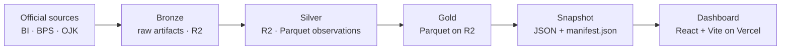
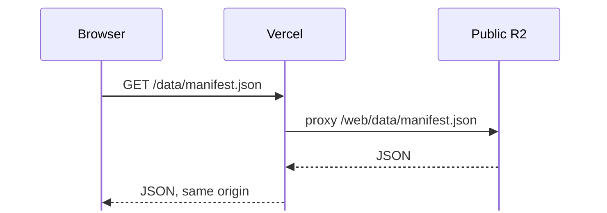

# Indonesia Financial Overview

A small data platform for official Indonesian macroeconomic and financial
indicators that runs on free tiers. Publications from Bank Indonesia, BPS, and OJK
enter Bronze as raw immutable files, are normalized into Silver Parquet, and
become a Gold layer persisted as Parquet in R2. Each Run publishes a static JSON
snapshot for the React dashboard.

Live dashboard: <https://indonesia-financial.web.id>

## Architecture



The browser reaches R2 through Vercel:



`web/vercel.json` performs that rewrite, so the browser needs no credentials and
the bucket needs no CORS rules. The rewrite also avoids `r2.dev`, which some
Indonesian ISPs hijack at the DNS level to a block page, so a direct browser fetch
fails on those networks.

## Sources

| ID | Source | Data | Access |
| --- | --- | --- | --- |
| `BI_SEKI` | Bank Indonesia SEKI | Policy rate and corridor, USD/IDR, money supply, fiscal and external tables | One ZIP per edition |
| `BI_JISDOR` | Bank Indonesia JISDOR | Daily USD/IDR reference rate | Date-range export form POST |
| `BPS` | Badan Pusat Statistik | Inflation, regional GDP | WebAPI JSON |
| `OJK_SPI` | OJK Banking Statistics | NPL, CAR, LDR, ROA, credit by sector | SJKPublic portal (MDX over SOAP) |

Each adapter runs on its own, so a parse failure in one Source leaves the others'
data intact. Parsers check structure and fail loudly when a publication changes
shape. Files are identified by magic bytes, and the extension is ignored.

## Lineage And Data Model

- Bronze keys on `source=<id>/edition_period=<period>/publication_checksum=<sha256>`.
  A re-released edition becomes a new Publication that records `supersedes`.
- Silver stores one long-form Parquet dataset per year. The business key excludes
  the checksum because the checksum is lineage, not identity. A revision flips
  `is_current` on the old row before inserting the new one.
- Gold reads current rows only and derives revision metadata during projection;
  Silver remains the source of truth for revision history.
- Gold facts and dimensions are written as Parquet under `gold/` with a manifest.
  The JSON snapshot is the denormalized copy the dashboard reads; Gold Parquet is
  derived and never read back as a pipeline input.
- Snapshot writes every Gold view plus `manifest.json`, which records the Run,
  `SCHEMA_VERSION`, and per-file checksums so a partial upload is visible.

A missing period is `skipped` or `pending`; the pipeline does not write a zero row
for it. Plausibility flags go to review, and nothing is deleted automatically.

## Repository Layout

```
config/indicators.yml      indicator codes, units, sources, regimes, drift limits
pipeline/
  sources/                 one adapter per Source
  storage/                 R2 Bronze, Silver and Gold Parquet, S3 client
  run_monthly.py           entrypoint: ingest sources, reconcile, Gold, export
  export_web.py            rebuild Gold from Silver and publish the snapshot
  gold.py                  pandas Gold build: tables, views, snapshot
  quality.py               gates, freshness, drift
seeds/events.yml           curated event dataset
web/                       React + Vite dashboard and Vercel config
docs/                      PRD and architecture decision records
.github/workflows/         ci, monthly, export-web
tests/                     unit tests against committed fixtures
```

## Configuration

`config/indicators.yml` is the single source of truth for indicator codes, units,
frequencies, source mappings, regimes, and drift thresholds. Adapter code never
hardcodes an indicator label it can read from config. `CONTEXT.md` defines the
shared vocabulary; `docs/adr/` records why the architecture looks like this.

## Setup

Requires Python 3.12 with [uv](https://docs.astral.sh/uv/), and Node 22 for the
dashboard.

```bash
uv sync
uv run pytest
uv run ruff check .
uv run ruff format --check .
```

Create a local env file and fill in the values:

```bash
cp .env.example .env
```

| Variable | Purpose |
| --- | --- |
| `R2_ENDPOINT` | S3 endpoint: `https://<account_id>.r2.cloudflarestorage.com` |
| `R2_ACCESS_KEY_ID` | R2 API token key |
| `R2_SECRET_ACCESS_KEY` | R2 API token secret |
| `R2_BUCKET` | private Bronze, Silver, and Gold bucket |
| `R2_PUBLIC_BUCKET` | public bucket for the web snapshot |
| `R2_PUBLIC_PREFIX` | snapshot prefix, default `web/data` |
| `BPS_API_KEY` | BPS WebAPI key |
| `ALERT_WEBHOOK_URL` | optional alert target |

Secrets live only in environment variables. `.env` is gitignored; CI reads
GitHub secrets.

## Commands

```bash
uv run python -m pipeline.run_monthly                  # all Sources, lookback window
uv run python -m pipeline.run_monthly --sources BI_SEKI
uv run python -m pipeline.run_monthly --start 2024-01-01 --end 2024-12-31
uv run python -m pipeline.export_web                   # rebuild Gold and refresh JSON from Silver
uv run python -m pipeline.export_web --out web/public/data
```

`run_monthly` writes a Run and one Source Run per adapter under `ops/runs` in R2,
rebuilds Gold from Silver, and exports the snapshot. If the web export fails,
it logs and sends an alert without failing the ingestion Run.

## Automation

- `monthly.yml` runs at 02:30 UTC on weekdays (BI_JISDOR) and at 02:30 UTC on the
  15th-28th (SEKI release window), and accepts `start`/`end` for backfills.
- `export-web.yml` rebuilds Gold, rewrites the Gold Parquet tables, and
  republishes the snapshot without touching the sources. Run it from the Actions
  tab; it is not scheduled because re-exporting unchanged data would move
  `generated_at` without changing any value.
- GitHub disables scheduled workflows after 60 days without repository activity.
  `ALERT_WEBHOOK_URL` reports failures, and a periodic manual run re-arms the
  schedule.

## Deployment

1. Create two R2 buckets: a private one for Bronze, Silver, and Gold, and a public
   one for the snapshot with `r2.dev` access enabled.
2. Add the variables above as GitHub Actions secrets (`R2_PUBLIC_PREFIX` can be a
   repository variable). Trigger `monthly.yml` once and confirm
   `web/data/manifest.json` exists in the public bucket.
3. Import the repository into Vercel with root directory `web` and framework
   preset Vite. `web/.env.production` already sets `VITE_DATA_BASE_URL=/data` and
   `VITE_SITE_URL=https://indonesia-financial.web.id`; Vercel env vars override
   them.
4. Add the domain in Vercel and point the registrar's DNS at the records Vercel
   shows. `.web.id` cannot be a Cloudflare zone, so an R2 custom domain is not an
   option.
5. Set the `/data/:path*` rewrite destination in `web/vercel.json` to your
   public bucket's `r2.dev` URL. It is the only hardcoded value; rewrites cannot
   read environment variables.

Frontend details, local data setup, and SEO behavior are documented in
[web/README.md](web/README.md).

## Tests

Unit tests run offline against fixtures in `tests/fixtures/`. A parser change
updates its fixture and expected output in the same commit. Quality checks have
dedicated defect fixtures, so a known-bad publication fails its specific check
instead of crashing the pipeline.

```bash
uv run pytest
cd web && npm run lint && npm run build
```

## License

Code is licensed under [MIT](LICENSE). Data sources and snapshot terms are
described in [DATA-LICENSE.md](DATA-LICENSE.md).
